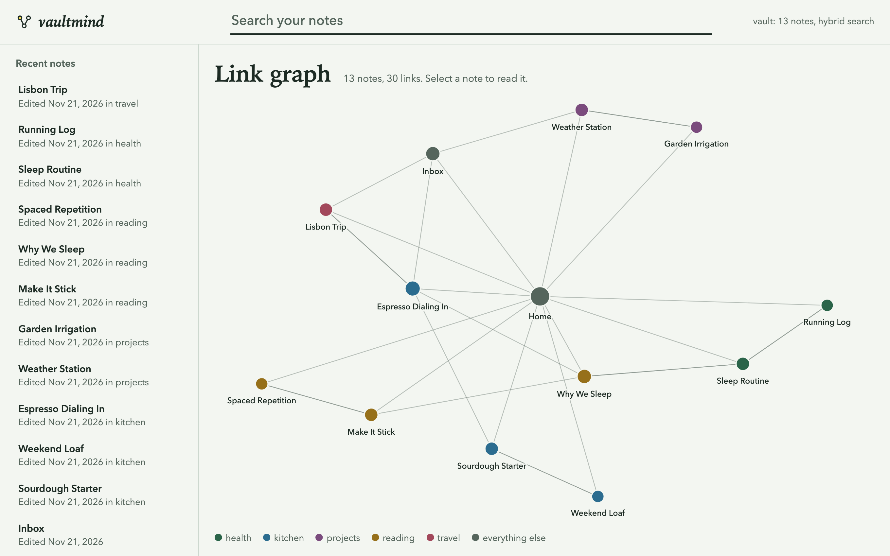
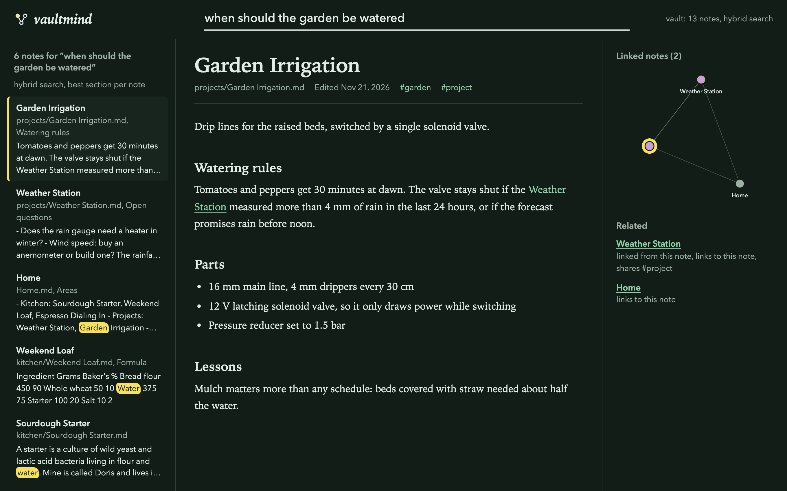
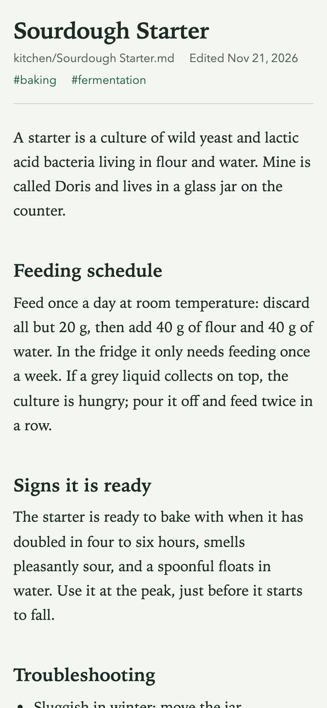

# vaultmind

Local-first search and an MCP server for a folder of Markdown notes (an Obsidian vault works as is).
It indexes your notes into one SQLite file, searches them by keyword and by meaning with a small model that runs on your machine, and lets Claude use the vault as memory. No account, no API key.








## Quickstart

You need Node.js 22.18 or newer (`node --version`) and git. The repository ships a small made-up vault to try things on.

```bash
git clone https://github.com/Habibeyilmazz/vaultmind.git
cd vaultmind
npm install
npm run build

node dist/cli.js index  --vault examples/vault
node dist/cli.js search "when should the garden be watered" --vault examples/vault
node dist/cli.js serve  --vault examples/vault      # then open http://127.0.0.1:4100
```

The first `index` downloads the embedding model (about 23 MB) from the Hugging Face hub and keeps it in `node_modules/@huggingface/transformers/.cache`. If that is not possible, or you pass `--no-embed`, everything still works with keyword search.

Recent npm versions end `npm install` with a warning that install scripts were blocked for `onnxruntime-node` and `protobufjs`. You can ignore it: the quickstart above was run from a fresh clone with those scripts blocked (macOS, npm 12) and the embeddings worked.

Point `--vault` at your own notes folder when you are ready. vaultmind only reads your notes (unless you start the MCP server with `--allow-write`, see below). The one thing it writes on its own is its index, at `<vault>/.vaultmind/index.db` (use `--db` to put it elsewhere, and add `.vaultmind/` to `.gitignore` if the vault is a git repository).

## Use your vault from Claude

vaultmind speaks the Model Context Protocol over stdio. Use absolute paths.

Claude Code:

```bash
claude mcp add vaultmind -- node /absolute/path/to/vaultmind/dist/cli.js mcp --vault /absolute/path/to/your/vault
```

Claude Desktop (`claude_desktop_config.json`):

```json
{
  "mcpServers": {
    "vaultmind": {
      "command": "node",
      "args": ["/absolute/path/to/vaultmind/dist/cli.js", "mcp", "--vault", "/absolute/path/to/your/vault"]
    }
  }
}
```

| Tool | What it does |
| --- | --- |
| `search_notes` | Finds notes for words or a question and returns the best matching section of each, with path, heading and line. Optional `tags` and `folder` narrow it. Paginated. |
| `get_note` | Returns one note by path, file name, alias or title: body, tags, frontmatter, outgoing links, backlinks. Long notes come in pieces. |
| `related_notes` | Lists notes connected to a note, with the reasons: links in either direction, shared tags, similar content. |
| `recent_notes` | Lists the most recently modified notes, or with `tags` / `folder` every note that matches, newest first. |

All four are read-only. Each takes `response_format: "markdown" | "json"`.

### Let Claude save notes (opt-in)

Add `--allow-write` after `mcp` and the server gains a fifth tool, `write_note`, so Claude can remember things in your vault, not only look them up. This matters most in Claude Desktop, which cannot write files without another tool.

```bash
claude mcp add vaultmind -- node /absolute/path/to/vaultmind/dist/cli.js mcp --allow-write --vault /absolute/path/to/your/vault
```

`write_note` takes a vault-relative `path` (`.md` is added if missing, folders are created), Markdown `content`, and `append`. It never overwrites, renames or deletes: creating a note that exists fails, and `append: true` adds the text as a new paragraph at the end (creating the note if it is missing). It refuses absolute paths, `..`, dot-folders such as `.obsidian`, symbolic links, characters Obsidian does not allow in names, and anything that would make a note larger than 5 MB. The new text is searchable as soon as the tool returns. Without the flag the server stays read-only.

Claude Code and Claude Desktop normally ask before calling an MCP tool you have not allowed, so you see each write first unless you allow `write_note` for good. A note Claude writes can hold text it read elsewhere, including clipped web pages; read what it saved if that matters to you.

### Watching and freshness

The server indexes the vault when it starts and watches it while it runs: a note you add, edit, rename or delete is searchable about half a second later, so Claude can find a note it just wrote. Where the folder cannot be watched (some network drives), it rescans at most every 30 seconds, on the next tool call. If the vault has never been embedded, search answers by keyword until the first embeddings are ready; run `index` beforehand to avoid that.

The tools hand note text to the model as written. If your vault holds clipped web pages, their text reaches the model too.

## Features

- **Hybrid search.** BM25 keyword ranking (SQLite FTS5) and vector similarity are fused with reciprocal rank fusion. Keyword search understands stemming (`fermenting` finds `ferment`) and ignores diacritics (`cafe` finds `café`).
- **Embeddings on your machine.** `Xenova/all-MiniLM-L6-v2` through transformers.js on the CPU. Without it, search falls back to keywords on its own.
- **Understands Obsidian notes.** YAML frontmatter (`title`, `tags`, `aliases`), inline `#tags` including `#nested/tags`, `[[wikilinks]]` with `|alias` and `#heading`, `![[embeds]]`, and relative Markdown links. Links resolve to the note next to the linking note first, then by path, file name and alias. Titles, aliases, headings and tags are all searchable.
- **Filter by tag and folder.** Type `tag:garden` or `path:projects` in the search box or after `vaultmind search`, alone or with words (`tag:project path:work deadline`). A tag covers its nested tags (`tag:project` finds `#project/active`), several `tag:` must all match, a folder includes its subfolders, and a quoted value may hold spaces (`path:"daily notes"`). On its own, a filter lists every matching note, newest first. Clicking a tag on a note does the same. The MCP tools take `tags` and `folder` parameters, and an unknown tag gets a reply that lists the vault's tags.
- **Respects Obsidian's "Excluded files".** Notes matched by Settings > Files and links > Excluded files (stored in `.obsidian/app.json`) are left out of the index, so templates and archives stop crowding results. A plain entry excludes every path that starts with it (`Templates/`), an entry between slashes is a regular expression (`/\.draft\.md$/`). `index` prints the entries it applied; a running server picks up a changed setting on its next rescan (within 30 s of a query). `write_note` refuses to write where the note would be excluded. Links to an excluded note count as unresolved.
- **Heading-aware chunks.** Each section is indexed with its heading path (`Sourdough Starter > Feeding schedule`), so a hit points at the part of the note that matched.
- **Incremental indexing.** Only new and changed files are read again. Deleted files leave the index.
- **Web UI.** Search as you type, a reading view, related notes with reasons, the notes linked to the current one, and the link graph of the whole vault, which zooms and pans (buttons, wheel, drag, pinch) and never draws one note name over another. Light and dark, works on a phone, keyboard friendly (`/` focuses search, arrow keys move through results).
- **Ask your vault (optional).** With `ANTHROPIC_API_KEY` set, `vaultmind ask "..."` and the Ask button in the web UI answer a question from the best matching sections and cite them. Without a key the button does not appear and nothing else changes.

## How it works

```
notes/*.md ──parse──▶ sections, tags, links ──▶ SQLite (.vaultmind/index.db)
                                                  ├─ notes, chunks, tags, links
                                                  ├─ chunks_fts   (FTS5, BM25)
                                                  └─ chunk vectors (384 floats each)

query ─┬─ FTS5 MATCH, bm25() ───────┐
       └─ embed, cosine over chunks ─┴─▶ reciprocal rank fusion over sections ─▶ best section per note
```

- `src/parse.ts` turns a file into title, tags, links and heading-scoped chunks (split at paragraph breaks above 1,000 characters).
- `src/indexer.ts` walks the vault, skips dot-folders such as `.obsidian`, compares size and modification time, then a content hash, and rewrites only what changed.
- `src/search.ts` holds search, related notes, recent notes and the graph. Vectors are compared by brute force, which is fast at personal-vault size.
- `src/mcp.ts`, `src/web.ts` and `src/main.ts` are thin fronts over the same functions. The web server is one `Request -> Response` function with a strict Content-Security-Policy; note content is rendered on the server with raw HTML escaped.

Uses Node's built-in `node:sqlite`, so there is no native module to compile.

Measured on an Apple M3 Pro with a generated vault of 2,000 notes (12,000 sections), in two sessions: keyword index 0.3 to 0.4 s, embedding all sections 35 to 52 s, a re-index with nothing changed 0.2 s including process start, a hybrid query through the web API 50 to 150 ms, index file 35 MB. The slower figures are from a run with other jobs busy on the same machine. It has not been measured on anything larger.

## Command line

```
vaultmind index              Build or update the index
vaultmind search <query>     Search from the terminal (tag:<tag> and path:<folder> narrow it)
vaultmind serve              Start the web UI on 127.0.0.1
vaultmind mcp                Run the MCP server on stdio (read-only; --allow-write adds write_note)
vaultmind ask <question>     Answer from your notes with citations (needs ANTHROPIC_API_KEY)

--vault <dir>     Vault folder (default: $VAULTMIND_VAULT, else the current directory)
--db <file>       Index file (default: <vault>/.vaultmind/index.db)
--no-embed        Keyword search only
--model <id>      Embedding model on the Hugging Face hub
--mode <mode>     search: auto | keyword | semantic
-n, --limit <n>   search: number of results
--json            search, ask: print JSON
-p, --port <n>    serve: port (default 4100)
--allow-write     mcp: let Claude create notes and append to them
```

Run it as `node dist/cli.js ...`, or `npm link` once to get a `vaultmind` command.

In a terminal, `search` prints titles and matched words in bold; piped, or with `NO_COLOR` set, it prints plain text.

## Privacy

Indexing, search, the MCP server and the web UI run entirely on your machine. Nothing but `write_note`, which is off unless you pass `--allow-write`, changes a note. The web UI listens on `127.0.0.1` only, refuses requests addressed to other host names, and never loads remote images from notes.

Two things use the network, both optional:

- the one-time model download from the Hugging Face hub;
- `ask`, which sends your question and up to eight matching note sections to the Anthropic API. It is off unless `ANTHROPIC_API_KEY` is set. The model defaults to `claude-opus-5-5`; set `VAULTMIND_ASK_MODEL` to change it.

## Limitations

- `ask` has never run against the live Anthropic API (no key was available while building). Tests cover it with a stubbed client and with the real SDK talking HTTP to a local stand-in server, so whether the live API accepts the request exactly as sent is still unconfirmed.
- The default embedding model, the stop-word list and the stemmer are English. Notes in other languages get keyword search with diacritic folding; Chinese and Japanese text is indexed one character at a time, so a word is found as a phrase of characters (no word segmentation, so short words also match inside longer ones); `--model` accepts another model but none has been tried.
- The link graph has zoom and pan but no filtering. Names that would collide stay hidden until you zoom in or hover; beyond a few hundred notes the unzoomed view is a dense cloud.
- Symbolic links inside the vault are not followed, so a linked note or folder is not indexed.
- Search returns one hit per note (its best section). Each ranking contributes its 100 best sections, at most three per note, so very broad queries are not exhaustive.
- Developed on macOS. CI runs the unit and MCP tests and the built CLI on Linux (Node 22.18 and 24) and on Windows (Node 22); a manually started workflow runs the real embedding model on Linux, Windows and macOS. The browser tests run on Linux and Windows; nobody has looked at the web UI by eye on Windows.
- Not published to npm; install from this repository.

## Compared with other tools

- **Obsidian's built-in search** is faster to reach and has richer operators, but matches words, not meaning, and Claude cannot use it. Keep using it; vaultmind adds meaning-based search and an MCP door.
- **Obsidian plugins with semantic search or chat** live inside the app and may offer more polish and editing integration. Prefer them if you only work inside Obsidian. vaultmind is a standalone process that also serves Claude Code and Claude Desktop, and needs Node.
- **Generic Markdown or filesystem MCP servers** read files by path or grep them. They are simpler to set up; vaultmind is worth it when your notes are many enough that you want ranked, section-level answers, tags and backlinks.
- **Hosted note and chat products** (cloud AI notebooks) do more, including other file types and sync, but your notes go to their servers. vaultmind keeps everything on your machine and handles Markdown only.
- **A DIY script** (embed files, store vectors, query) is a fine weekend project. vaultmind is that plus parsing of Obsidian syntax, incremental indexing, a UI and tests.

I have not benchmarked vaultmind against any of these, so no claim here is about quality or speed.

## Roadmap

- Filtering in the link graph
- A multilingual embedding model option that is actually tested
- Publish to npm so `npx vaultmind` works
- A vector index for vaults far beyond 50,000 sections

## Contributing

Bug reports and small, focused pull requests are welcome. See [CONTRIBUTING.md](CONTRIBUTING.md); please keep notes out of issues, the example vault is enough to reproduce most things.

## Development

```bash
npm run typecheck
npm test              # parser, index, search, web API, ask (stubbed and against a local stand-in), MCP over stdio
npm run e2e           # drives the web UI in Chromium; run `npx playwright install chromium` once; `node scripts/demo.ts` re-records the demo GIF (needs ffmpeg)
```

`evals/example-vault.xml` holds ten question/answer pairs for the MCP server over the example vault, in the mcp-builder evaluation format. The answers were checked by hand; the set has not been run through an LLM harness yet.

Tests run TypeScript directly with Node's type stripping, against a temporary copy of `examples/vault`. See [CHANGELOG.md](CHANGELOG.md) for what changed and what is next.

## License

[MIT](LICENSE)
